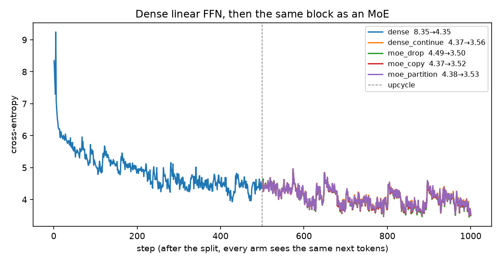
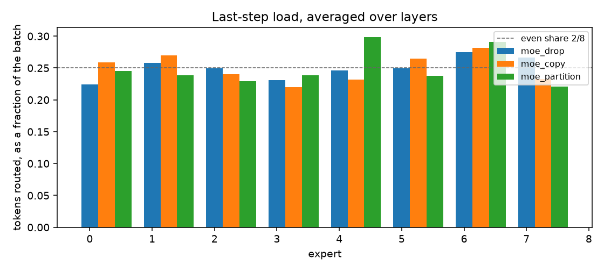
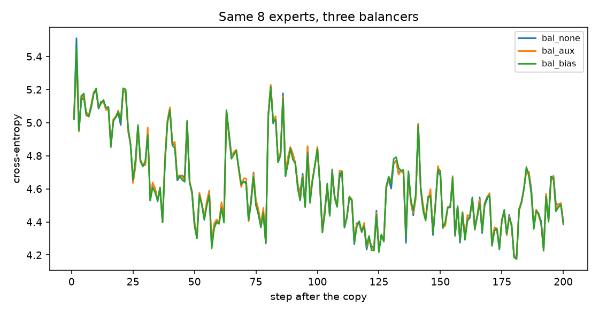
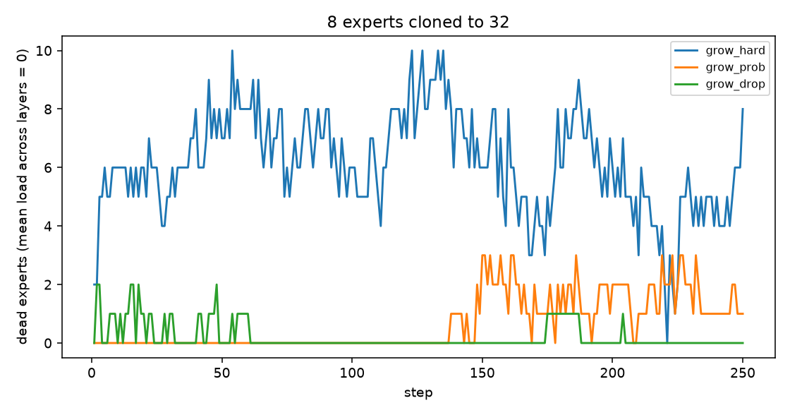

# Session 14 — a dense linear block, then the same block as an MoE

**ERA V5** · Author: `shivman`

I trained a small GPT whose feed-forward block is one linear map. After the loss was falling, I turned that map into a mixture of experts three ways and kept training. Every arm kept training, and every arm’s loss kept falling. The step log is [`logs/train.jsonl`](./logs/train.jsonl) (2,500 lines). The same numbers are in [`results.json`](./results.json).

**Notebook:** [`session14_linear_to_moe.ipynb`](./session14_linear_to_moe.ipynb)  
**Script:** [`moe_loop.py`](./moe_loop.py)

```bash
python moe_loop.py --steps-dense 500 --steps-after 500 --batch 32
```

This machine: **Apple MPS**, `torch 2.13`. No CUDA.

---

## What I converted

The assignment says to train a linear model and turn it into an MoE. The linear model is the dense feed-forward block: one `Linear → GELU → Linear`. Attention stays. That block is what changes.

I picked the MoE first (8 experts, top-2), then sized the linear block so the larger model still fits on this Mac. All four arms after the split start from the **same** dense checkpoint and read the **same** next tokens.

| method | how it starts | what changes size |
|--------|---------------|-------------------|
| **copy** | every expert is that MLP; only the router is new | expert width stays 512 |
| **drop** | the same copy, then half the hidden units are redrawn (`r = 0.5`) | width stays 512; 256 units are new |
| **partition** | the MLP becomes a shared expert, always on; each routed expert keeps a random half of the units | routed width **512 → 256** |

One arm does not convert. It keeps the dense MLP for the same extra steps.

Router, matching the worked example in class: softmax over all experts, keep top-2, rescale so those two weights sum to 1. The router runs in fp32 and starts small (`std = 0.002`). A per-expert bias is added **only when choosing**, then moved by `0.001 * sign(mean load − load)`. It does not enter the output weights. No tokens are dropped.

The lecture’s 8-expert example checks out: logits `[2.0, 0.5, 1.2, −0.3, 0.9, 1.8, −1.0, 0.1]` give softmax `0.320` and `0.262` on experts 0 and 5, and rescaled weights `0.550` and `0.450`.

### Shapes, one layer

| tensor | dense | copy / drop expert | partition routed | partition shared |
|--------|------:|-------------------:|-----------------:|-----------------:|
| `fc1` | 512 × 128 | 512 × 128 | **256 × 128** | 512 × 128 |
| `fc2` | 128 × 512 | 128 × 512 | **128 × 256** | 128 × 512 |
| router | — | 8 × 128 | 8 × 128 | — |

Copy matches the dense forward pass before any MoE step: max `|Δlogit| = 8.1e-6`. Drop does not (gap **7.02**), because 256 of 512 units are random. Partition’s shared expert is the old MLP, and the routed halves are extra, so the gap is **2.16** and the first-step loss barely moves.

---

## The model

| | dense | copy / drop | partition |
|--|------:|------------:|----------:|
| hidden / layers / heads | 128 / 4 / 4 | same | same |
| context | 64 | 64 | 64 |
| **parameters** | **1,323,776** | **5,015,808** | **3,437,312** |
| **active parameters** | 1,323,776 | 1,854,720 | 1,855,232 |
| vocab | 4096 BPE, tied | same | same |
| data | TinyStories, 3,071,463 tokens | same stream | same stream |
| AdamW | `lr=3e-3`, `β=(0.9, 0.95)`, `wd=0.01` | fresh optimizer after the split | same |

Each phase is 500 steps, batch 32, so **1,024,000** tokens.

---

## Loss kept falling

From `results.json`. Mean is the last 50 steps, because a single last step jumps around.

| phase | start CE | end CE | mean last 50 | tok/s | wall |
|-------|--------:|-------:|-------------:|------:|-----:|
| dense | 8.345 | **4.347** | 4.387 | 53,931 | 19.0 s |
| dense, continued | 4.368 | 3.557 | 3.904 | 56,671 | 18.1 s |
| **MoE drop** | 4.486 | **3.497** | **3.840** | 7,687 | 133.2 s |
| MoE copy | 4.368 | 3.518 | 3.857 | 6,358 | 161.1 s |
| MoE partition | 4.378 | 3.531 | 3.883 | 6,970 | 146.9 s |



- The dense run starts at `ln(4096) ≈ 8.32` and is at 4.35 after 500 steps.
- After the split, all three MoE arms and the dense continuation keep going down over the next 1,024,000 tokens.
- Copy’s first step is the same loss as the dense continuation (4.368). That is what a perfect copy should do.
- Drop pays a small jump at the splice (4.486) and then finishes slightly ahead on this budget (mean 3.840 vs dense 3.904).
- Partition is the conversion where the matrix sizes change. It still trains, and it still ends lower than where it started (4.378 → 3.531).

---

## Load

Last step, mean over the 4 layers. Even share for top-2 of 8 is `2/8 = 0.25`. Dead experts at that step: **0** in every arm.

| expert | 0 | 1 | 2 | 3 | 4 | 5 | 6 | 7 |
|--------|--:|--:|--:|--:|--:|--:|--:|--:|
| drop | 0.224 | 0.258 | 0.249 | 0.231 | 0.246 | 0.250 | 0.275 | 0.267 |
| copy | 0.259 | 0.270 | 0.240 | 0.220 | 0.232 | 0.265 | 0.282 | 0.233 |
| partition | 0.246 | 0.238 | 0.229 | 0.239 | 0.299 | 0.238 | 0.291 | 0.221 |



The bias step is 0.001, so 500 steps cannot move a bias by more than 0.5. That was enough to keep every expert alive.

---

## Routing, a second growth, and balancing

Same dense model, trained 200 steps (loss 8.345 → 4.963), then copied into 8 experts. These runs are in [`logs/extras.jsonl`](./logs/extras.jsonl) (1,550 lines) and [`results_extras.json`](./results_extras.json).

### Three balancers, 200 more steps, batch 32

The logged loss for the auxiliary arm is language loss plus the auxiliary term. At step 1 that term is 0.010, which is α. By the end the three losses sit together. What changes is the load.

| balancer | end CE | mean last 20 | mean max violation, last 20 | dead |
|----------|-------:|-------------:|----------------------------:|-----:|
| none | 4.399 | 4.499 | **0.558** | 0 |
| auxiliary, α = 0.01 | 4.401 | 4.495 | 0.241 | 0 |
| **bias, γ = 0.001** | **4.386** | **4.488** | **0.211** | 0 |



Nobody died in 200 steps with only 8 experts. The bias still produced the flattest load, and it did not raise the language loss. That is why the lecture uses the bias for choosing and leaves the loss alone.

### 8 experts cloned to 32

Each of the 8 experts is copied 4 times (17.7M parameters, 1.87M active). Batch 8, 250 steps, 128,000 tokens. Exact clones get only `1e-5` router noise. The half-redrawn clones use `r = 0.5` and the bias.

| growth | routing | max dead during the run | dead at the last step | end CE |
|--------|---------|------------------------:|----------------------:|-------:|
| exact clones | hard top-k the whole way | **10** | **8** | 4.882 |
| exact clones | probabilistic for 125 steps, then hard top-k | 3 | 1 | 5.004 |
| half redrawn | hard top-k, with the bias | 2 | **0** | 4.976 |



Hard top-k on identical clones is the failure from class: by step 50, 7 experts are empty, and 8 are empty at the end. Probabilistic selection keeps the dead count at 0 for the first half. Dead experts show up only after the switch back to hard top-k. Redrawing half the units, and balancing with the bias, keeps the last step at 0 dead. All three still end lower than they started.

## What this run is

This is the conversion the assignment asks for, on a model that fits here. It is not the 30.5B reference shape (128 experts, top-8, width 768). The router rule is the same. Copy and drop keep a full-width expert, so active parameters rise (1.32M → 1.85M) because top-2 runs two of them. Partition is the one that cuts the routed width in half and parks the original map in a shared expert. MoE is slower here (about 7k tok/s vs 57k) because the experts run in a Python loop. No expert parallelism.
